# HA² (Home Hermes Agent Assistant)

  

**Un proyecto de RUYMANIA · Archivo privado de desarrollo · Validación física parcial**

[Español](#español) · [English](#english)

## Español

HA² conecta una **XiaoZhi Ball V2**, **Home Assistant** y **Hermes Agent** para ofrecer conversación por voz, una interfaz circular animada y notificaciones coordinadas desde Home Assistant. Hermes aporta conversación, herramientas y resultados de sus tareas; Home Assistant conserva la autoridad sobre las reglas y la entrega de avisos; la Ball presenta información y ejecuta la interacción local.

Este repositorio documenta y conserva una **copia saneada del trabajo existente**, no un producto listo para instalar ni una copia de seguridad de la vivienda. La configuración privada se ha omitido o sustituido por ejemplos. Las adaptaciones de publicación **no se han desplegado** en los equipos operativos.

### ¿La Ball no sale de START?

Si el GIF START se repite y la pulsación de **1 segundo** no abre el menú, comprueba la IP actual y la conexión de la entrada **ESPHome** antes de resetear o reflashear. [Guía de recuperación y prevención](docs/SOLUCION-START-IP.md). Se recomienda **reserva DHCP en el router** para una dirección estable; esta guía no la aplica ni garantiza resolver todas las causas de START.

### Activación por voz: «Okey Hermes»

**«Okey Hermes» está integrado y funciona en las pruebas físicas de RUYMANIA tanto hablando en español como en inglés.** Confirmación bilingüe: **1 de noviembre de 2026**. La integración corresponde a firmware **1.3.2**, instalado el 29 de octubre de 2026.

Se incluyen [los pesos y el manifiesto ESPHome originales](firmware/models/okey-hermes/). El modelo se entrenó en español (`trained_languages: [es]`); la prueba de uso en ambos idiomas no cambia esos metadatos ni supone un benchmark bilingüe. No debe confundirse con el modelo anterior **Hey Hermes**. [Detalles y alcance de la validación](docs/OKEY-HERMES.md).

### Menú de la Ball: mantén pulsado 1 segundo

Mantén pulsada la pantalla aproximadamente **1 segundo** para abrir el menú. Recorre las secciones con las flechas laterales o con un deslizamiento lateral.

Estas fotografías muestran la interfaz en **español**. Pulsa una imagen para verla ampliada. Los ajustes visibles son los de la fotografía, no valores iniciales garantizados; las imágenes no certifican el funcionamiento de cada acción.

| Proyecto | Idioma | Tarjetas | Volumen |
| --- | --- | --- | --- |
| 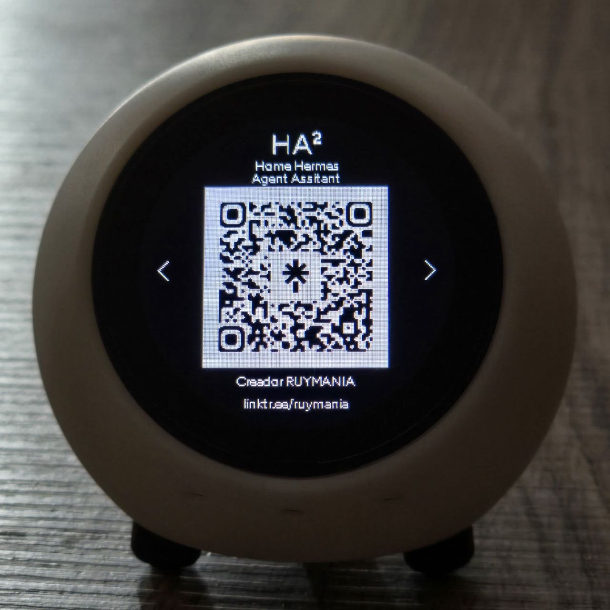 | 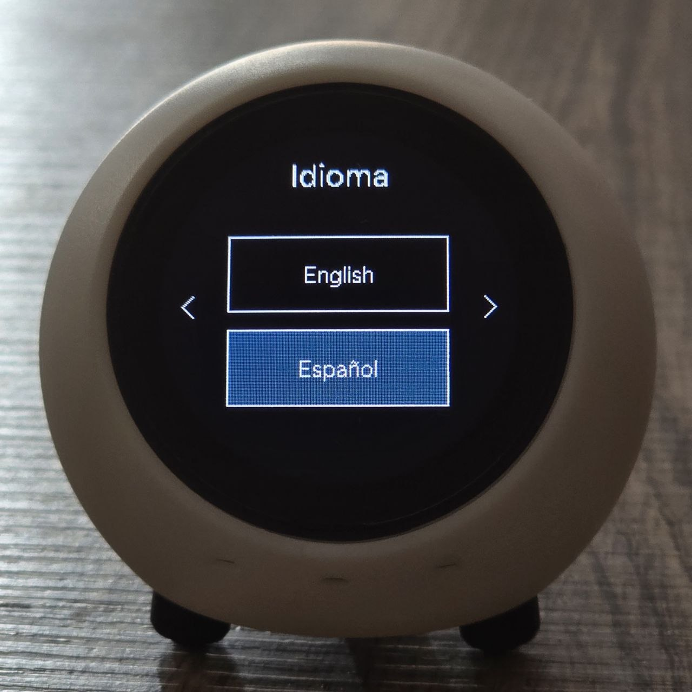 | 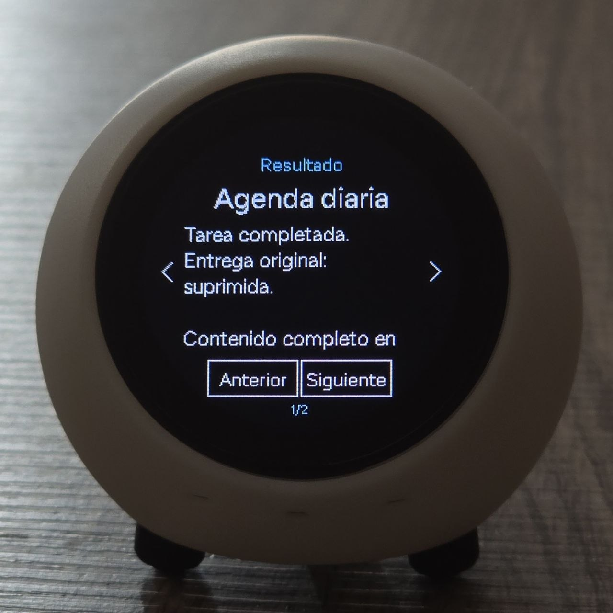 | 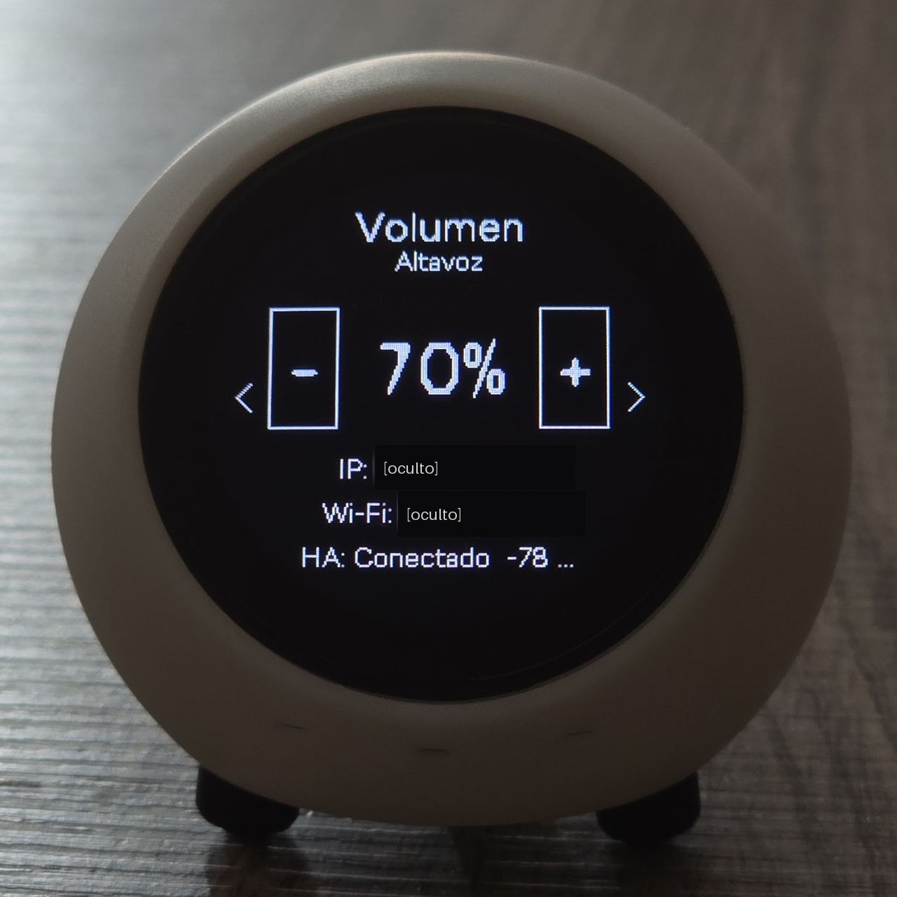 |

| Reposo | Despertar | Modo noche | Salir y mantenimiento |
| --- | --- | --- | --- |
| 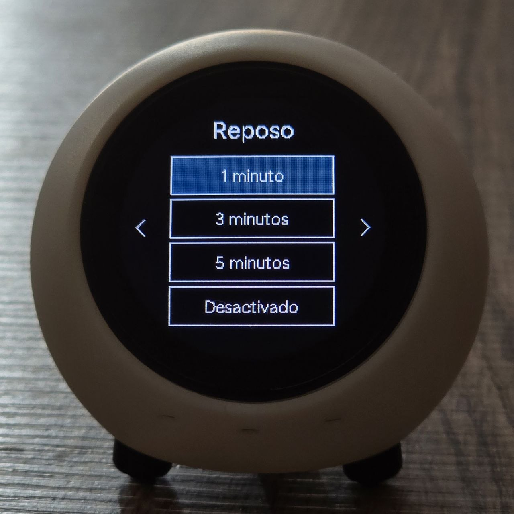 | 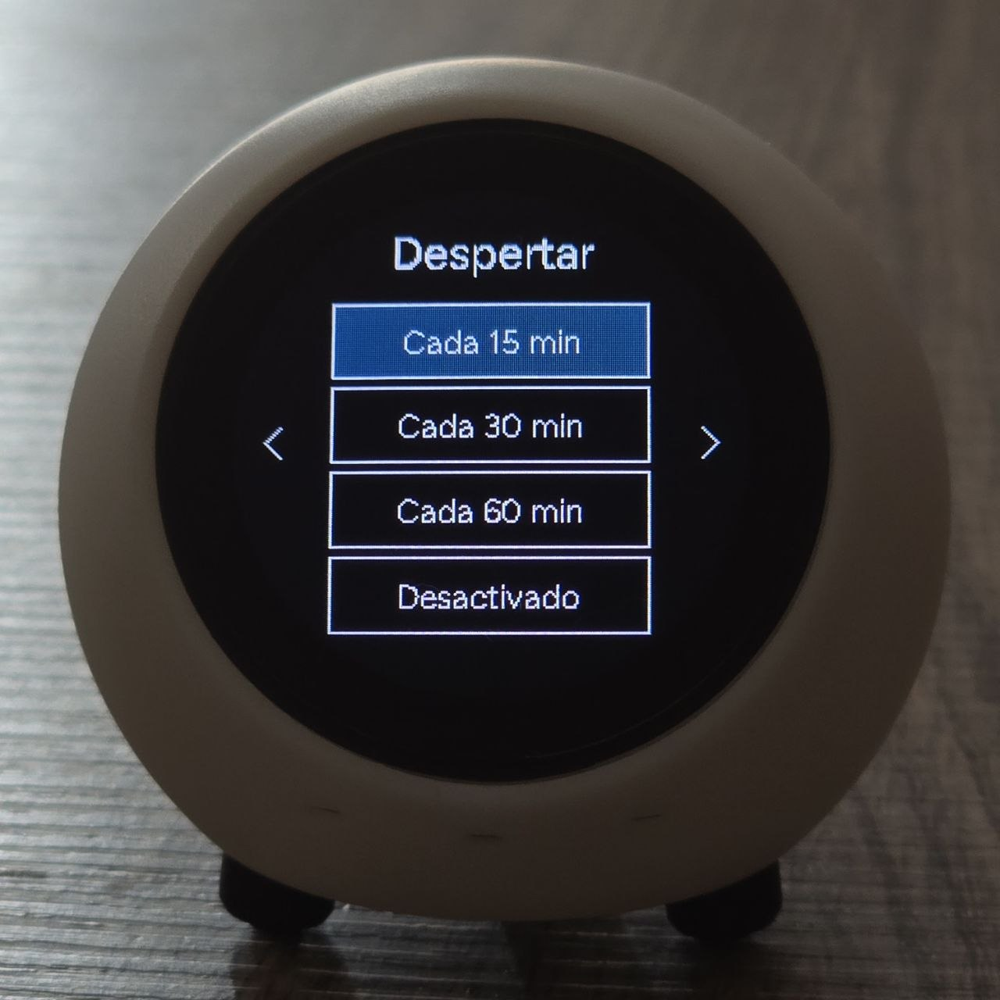 | 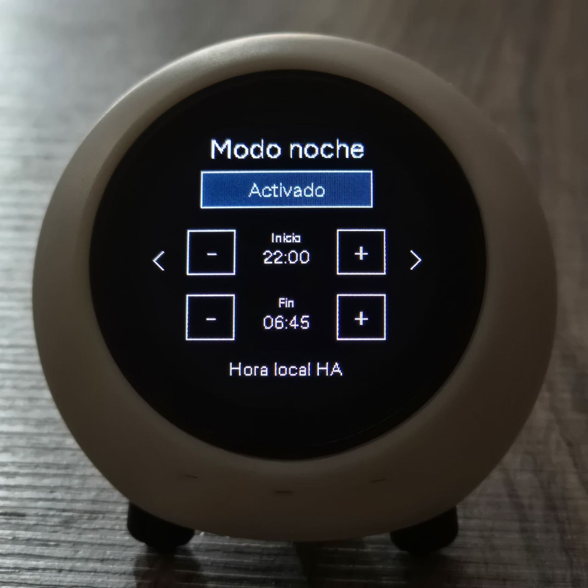 | 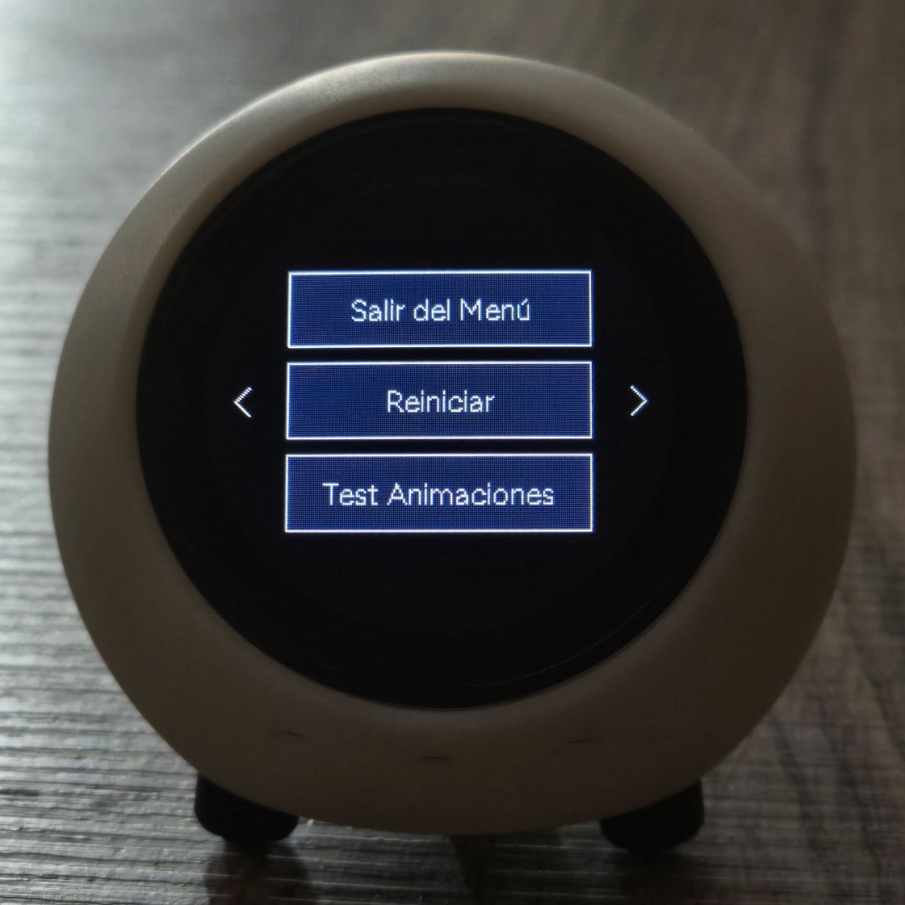 |

[Ver la guía visual completa, con fotos ES/EN emparejadas](docs/MENU-VISUAL.md). El idioma cambia los controles, no el contenido recibido de las tarjetas.

### Estado de referencia

| Superficie | Base documentada | Alcance |
|---|---|---|
| Ball / ESPHome | HA² 1.3.2, build 2026-10-29 13:28:53 UTC | Okey Hermes integrado y aceptado físicamente; uso ES/EN confirmado por RUYMANIA |
| HA² Notifications | 0.3.0 con cambios posteriores de 27–29 de octubre | Log de Actividad unificado, rótulos actualizados e invitaciones proactivas cortas; versiones y hashes en su snapshot |
| Companion de Hermes / adaptador HA | 0.1.0 con ampliaciones locales | El número nominal no identifica todos los parches |
| Plugin Home Assistant para Hermes | 2.0.1 con puente HA² | El puente conserva internamente versión 0.2.0; admite backend 0.2.0/0.3.0 |
| Proactivo | Aprobado por RUYMANIA, sin etiqueta BETA | ACTIVO según cierres posteriores; la publicación no cambia su configuración ni fabrica una ejecución automática |

**No todas las funciones han sido probadas físicamente.** Un ACK, una prueba host o un hash correcto no demuestran audibilidad, tacto ni reproducción en el dispositivo.

### Contenido

- [`firmware/`](firmware/): fuentes ESPHome/C++, configuración ejemplo, animaciones, recursos y modelo de activación con su licencia.
- [`homeassistant/`](homeassistant/): integración HA² Notifications, panel y adaptador de conversación Hermes.
- [`hermes/`](hermes/): companion, backend de tarjetas y plugin/puente de tareas.
- [`docs/`](docs/): arquitectura, uso, instalación, seguridad, pruebas y pendientes, en español.
- Cada superficie conserva un manifiesto de procedencia y los límites de su snapshot.

### Empieza aquí

1. [Índice de documentación](docs/INDICE.md).
2. [Arquitectura y contratos](docs/ARQUITECTURA.md).
3. [Instalación y dependencias](docs/INSTALACION.md): guía de ingeniería, **no instalador automático**.
4. [Estado, pruebas y aceptación pendiente](docs/ESTADO-Y-PRUEBAS.md).
5. [Seguridad y límites del archivo](SECURITY.md).
6. [Procedencia y derechos](THIRD_PARTY.md). **No hay una licencia abierta global elegida para el código propio ni para todos los recursos creativos.**

El título del proyecto utiliza **Assistant**, como ha solicitado RUYMANIA. Algunas fuentes instaladas y recursos históricos conservan **Assitant**. No se han cambiado esos textos ni identificadores técnicos como efecto lateral del archivo.

## English

HA² links a **XiaoZhi Ball V2**, **Home Assistant**, and **Hermes Agent** to provide voice interaction, an animated circular display, and coordinated notifications. Hermes handles conversations, tools, and task results. Home Assistant owns notification rules and delivery coordination. The Ball provides the local user interface.

### Ball stuck on START?

If START keeps looping and a **1-second press** does not open the menu, check the current IP and the existing **ESPHome** connection before resetting or reflashing. [Recovery and prevention guide](docs/SOLUCION-START-IP.md) (Spanish). A **router DHCP reservation** is recommended for a stable address; the guide does not apply it or claim to fix every possible START issue.

### Voice activation: “Okey Hermes”

**“Okey Hermes” is integrated and works in RUYMANIA's hands-on tests when speaking both Spanish and English.** Bilingual confirmation: **1 November 2026**. It is included in firmware **1.3.2**, installed on 29 October 2026.

The [original weights and ESPHome manifest](firmware/models/okey-hermes/) are included. The model was trained in Spanish (`trained_languages: [es]`); successful use in both languages does not change its training metadata or constitute a bilingual benchmark. It is distinct from the earlier **Hey Hermes** model. [Technical details and validation scope](docs/OKEY-HERMES.md) (Spanish).

### Ball menu: press and hold for 1 second

Press and hold the screen for approximately **1 second** to open the menu. Use the side arrows or swipe sideways to move between sections.

These photographs show the **English** interface. Click an image for a larger view. Visible settings are examples from the photographs, not guaranteed defaults or proof that every action has been tested. The interface language does not translate received card content.

| Project | Language | Cards | Volume |
| --- | --- | --- | --- |
| 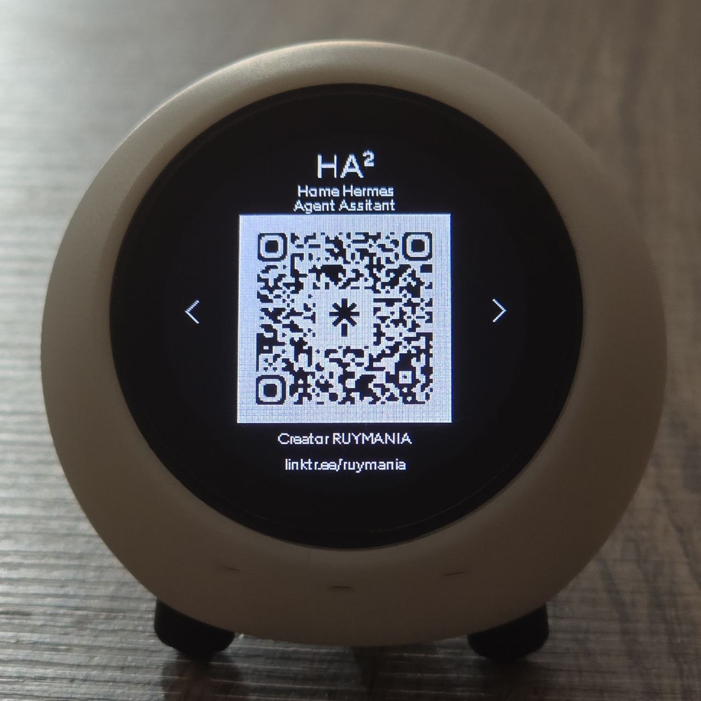 | 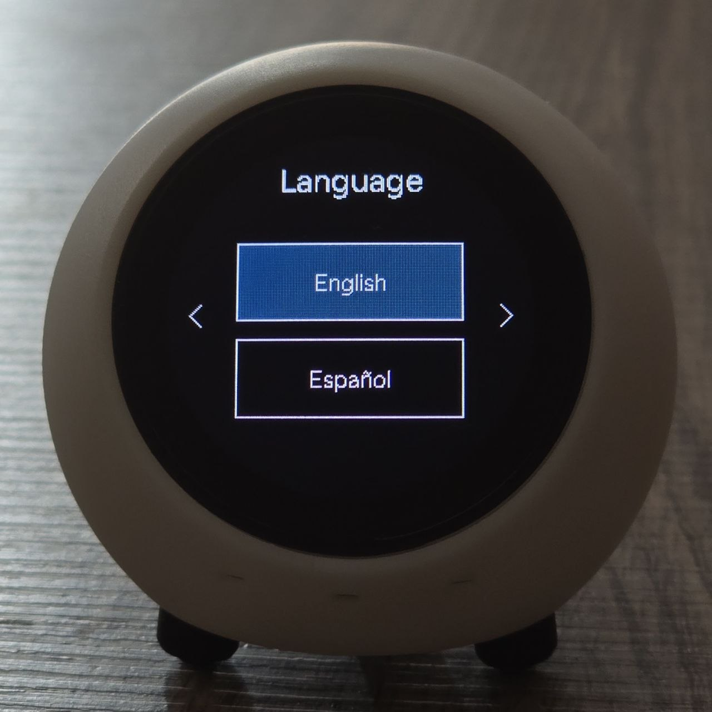 | 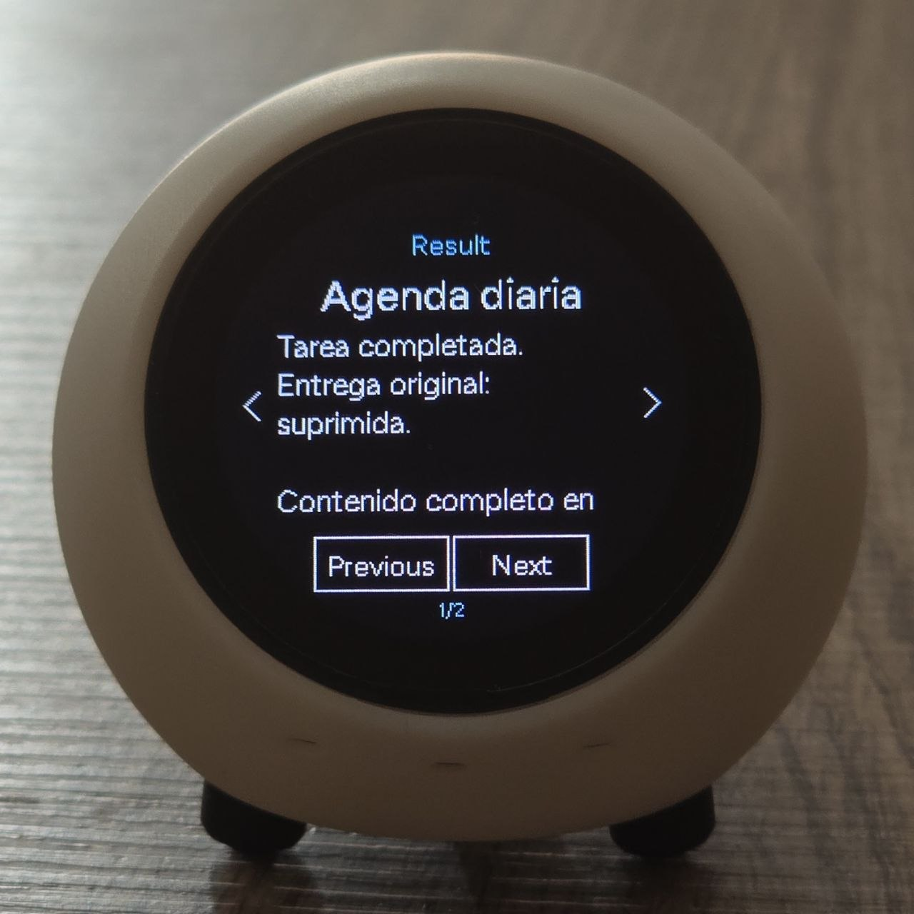 | 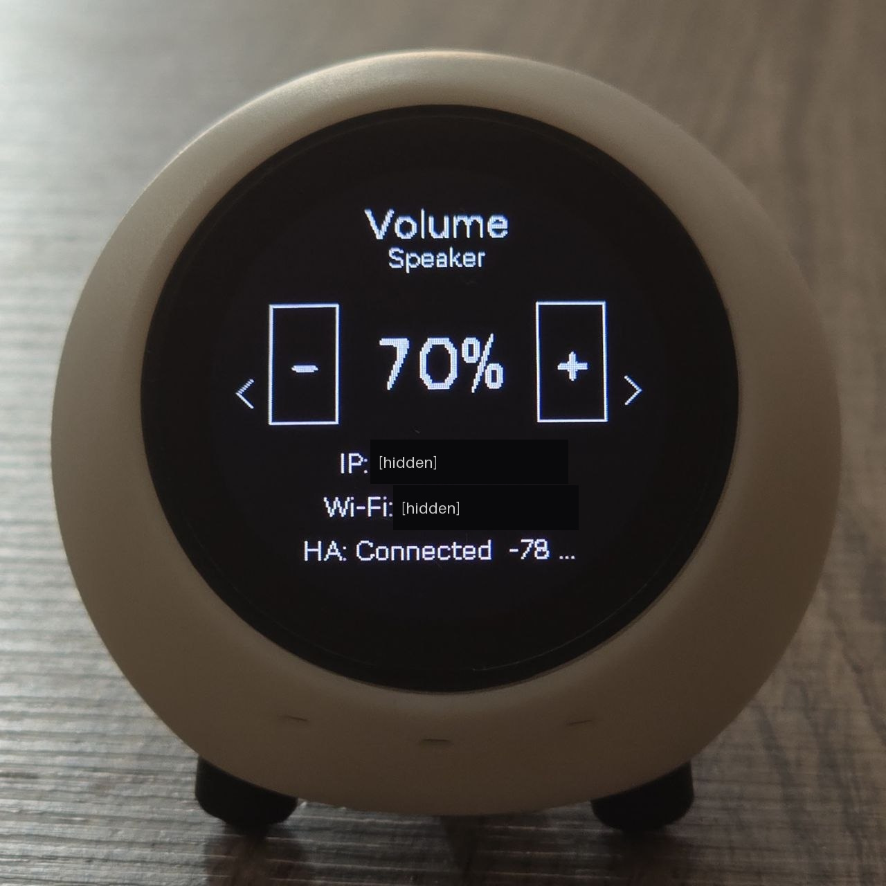 |

| Sleep | Auto wake | Night mode | Exit and maintenance |
| --- | --- | --- | --- |
|  | 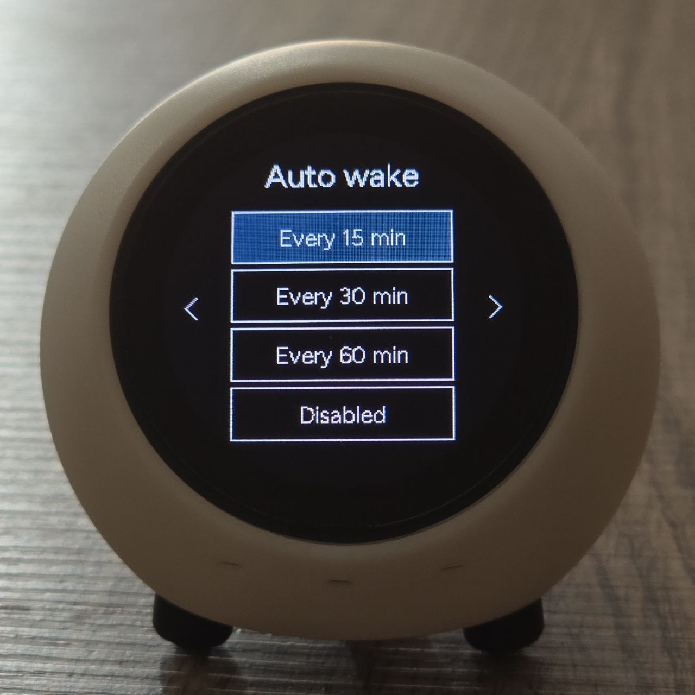 | 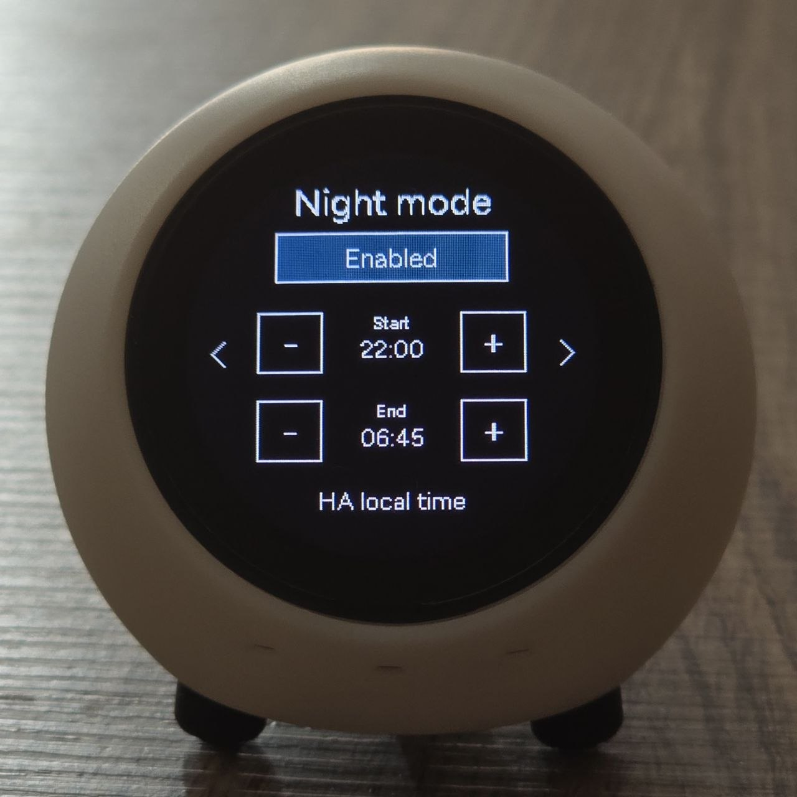 | 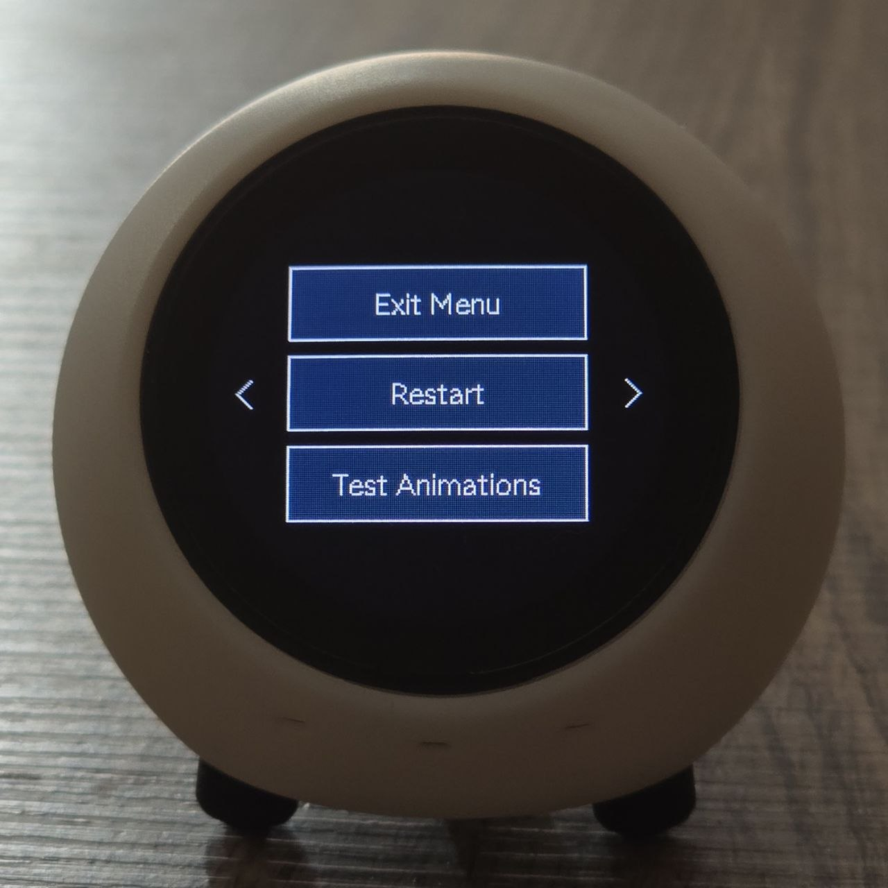 |

[Open the full visual guide with paired ES/EN photos](docs/MENU-VISUAL.md) (explanations in Spanish).

This is a **private, sanitized development snapshot**, not a turnkey release or a backup of a household installation. Private configuration is omitted or replaced with examples. Publication changes have **not** been deployed to the running systems.

The documented baseline is firmware **1.3.2** and HA² Notifications **0.3.0 with deployed updates from 27–29 October 2026**. These include the unified Activity Log and short proactive openers. Proactive mode has RUYMANIA's approval, is no longer labelled BETA, and is recorded as active in the later deployment records. This repository update does not change its live configuration or claim a new automatic delivery test. Okey Hermes has the separate hands-on Spanish/English confirmation described above.

See [`firmware/`](firmware/), [`homeassistant/`](homeassistant/), and [`hermes/`](hermes/) for each surface. Technical documentation is currently **in Spanish**; English translation will follow project approval. See [the documentation index](docs/INDICE.md) and [security notes](SECURITY.md) before attempting installation.

Do not flash compiled binaries from the original household installation, commit credentials, or run deployment/live test scripts against production. Original OTA/ELF binaries, sessions, private rules, databases and logs are deliberately excluded. Preserved tests are not all portable; each snapshot describes its prerequisites and verified subset.

Third-party notices remain applicable. No blanket open-source license has been selected for original HA² code or all artwork/audio. Keeping an asset in this private archive does not certify that it is cleared for public redistribution. The display spelling **Assitant** in historical resources is preserved; the repository title is **HA² (Home Hermes Agent Assistant)**.
